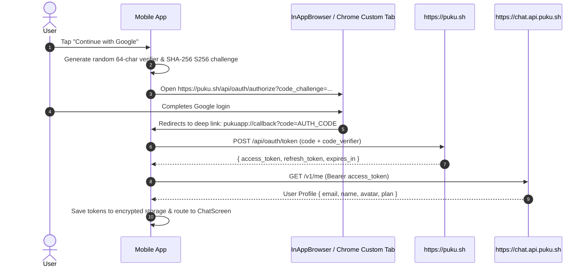

# Puku AI — API, Authentication & Remote Relay

This document details the backend endpoints, OAuth 2.0 PKCE authentication flow, session token storage, and desktop relay pairing protocol used by **Puku AI**.

---

## 1. Environment & Endpoints

Declared in `src/config/env.ts`:

| Key | Value | Purpose |
| :--- | :--- | :--- |
| `API_BASE_URL` | `https://chat.api.puku.sh` | Main chat streaming, conversations & projects API |
| `AUTH_BASE_URL` | `https://puku.sh` | OAuth 2.0 provider, email login & magic link |
| `AUTH_CLIENT_ID` | `puku-app` | Mobile OAuth Client Identifier |
| `AUTH_REDIRECT_URI` | `pukuapp://callback/` | Deep link scheme registered in Android & iOS |
| `REMOTE_SESSION_RELAY_HOST` | `https://puku-cli.relay.puku.sh` | WebSocket relay server for desktop CLI pairing |

---

## 2. Authentication Flow

Puku AI provides two primary authentication paths:

### Path A: Google OAuth 2.0 with PKCE (RFC 7636)

#### Manual Code Fallback
If the device browser or OEM restricts custom tab deep link redirection, the in-app Google Sign-In modal provides an explicit fallback input where users can paste the authorization callback URL or code directly to complete verification.

---

### Path B: Direct Email / Password & Bearer Token

For enterprise users or automated workflows:
1. Users can input their email and account password.
2. Users can paste an authentic Puku JWT Bearer token directly.
3. The app decodes JWT payloads (`email`, `sub`, `exp`) and verifies permissions against `/v1/me`.

---

## 3. Token Manager (`src/services/tokenManager.ts`)

- **Secure Storage**: `accessToken` and `refreshToken` live in encrypted storage via `src/services/secureStorage.ts` (`expo-secure-store`: Keychain on iOS, Keystore-backed storage on Android). Tokens saved in plaintext AsyncStorage by older versions migrate on first read. The expiry timestamp and login flags stay in AsyncStorage. The OAuth PKCE verifier and state also use encrypted storage and are deleted after sign-in.
- **Fallback**: if the native module is missing (for example an iOS build made before `pod install`), `secureStorage` falls back to AsyncStorage instead of crashing.
- **Automatic Header Injection**: Attaches `Authorization: Bearer <token>` to all HTTP requests via `pukuApi`.
- **Session Auto-Validation**: On cold boot, checks token validity; if valid, skips the login screen and opens the workspace immediately.

---

## 4. Desktop Remote Session Relay Protocol

Puku AI can pair with a developer's desktop command-line environment (`puku-cli`), started there with `/remote-control`. The full wire protocol is in the Flutter app's `REMOTE_SESSION_GUIDE.md`; this is how the React Native app implements it.

**Code layout**

| File | Role |
|---|---|
| `src/features/remote_session/relay/protocol.ts` | Pure reducer: `applyFrame(state, frame)` returns the next state plus effects (send, vibrate, save reconnect token, close). Outgoing frame builders. Unit-tested in `__tests__/RemoteRelayProtocol.test.ts`. |
| `src/features/remote_session/relay/feed.ts` | Groups consecutive tool calls into "Ran N commands" rows. |
| `src/store/RemoteSessionContext.tsx` | `RemoteSessionProvider` / `useRemoteSession()`: owns the WebSocket, reconnects, runs effects. Separate from `AppContext` so streamed output only re-renders remote-session screens. |
| `src/features/remote_session/` | Screen and components (feed, composer, permission card, tool sheet, pairing). |

**Connection**

1. Sessions on the user's account are listed from `GET /v1/sessions?mine=1`, polled every 5s while the pairing view is open (30s after a 401/403, paused in the background). Only sessions with `workerConnected` and not `expired` count as live.
2. The app opens `wss://puku-cli.relay.puku.sh/client/<sessionId>?token=<mobileToken>[&reconnectToken=<token>]` with the `X-Puku-Mobile-Token` and `X-Puku-Account-Token` headers.
3. Input stays disabled until `worker_connected` or `system/init` arrives (phase `attached`), not merely when the socket opens.
4. The `system/reconnect_token` frame is saved in encrypted storage per session and sent on the next connect.

**Disconnects**: close code 1000 or any 4xxx ends the session. Anything else (1006 network drop, 1011 CLI gone) retries with backoff 3s, 6s, 12s, then every 30s, for up to 20 attempts, and immediately when the app returns to the foreground. `worker_disconnected` disables input but keeps the socket; `client_replaced` and `session_end` close it. Frames replayed after a reconnect are de-duplicated by `uuid`.

**Output**: `assistant` frames add text and tool calls. `stream_event` text deltas show live and are replaced by the final `assistant` frame. `tool_result` blocks attach to their `tool_use` by id, with `is_error` shown as a failure.

**Prompts** (`control_request` / `can_use_tool`): shown as an Allow/Deny card; `AskUserQuestion` renders as a picker whose answers go back in `updatedInput.answers` (multi-select joined with `", "`). `control_cancel_request` dismisses the card. Unknown `control_request` subtypes get an `error` reply so the CLI does not hang.

**Composer controls**: the permission mode and model pickers send `set_permission_mode` / `set_model` and apply the change on a `success` response; an `error` response is shown to the user.

