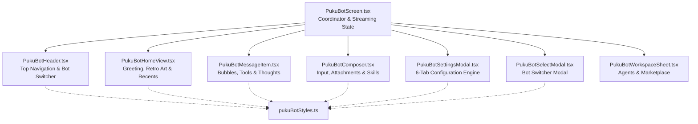

# Puku Bot — Modular Architecture & System Design

This document details the modular architecture, component responsibilities, state synchronization, authentication lifecycle, and tool execution engine powering **Puku Bot** (`src/features/puku_bot/`).

---

## 1. Architectural Overview & Component Split

Originally contained within a monolithic file (~4,000 lines), **Puku Bot** has been split into clean, single-responsibility components:

---

## 2. Component Directory & Responsibilities

| Component | File | Responsibilities |
| :--- | :--- | :--- |
| **PukuBotScreen** | [`PukuBotScreen.tsx`](file:///home/iftakhar/Poridhi/puku%20ai/src/features/puku_bot/PukuBotScreen.tsx) | **Screen-level coordinator**: Manages active conversation ID, message list state, SSE streaming lifecycle, offline outbox sync, and human-in-the-loop secret prompt. |
| **PukuBotHeader** | [`PukuBotHeader.tsx`](file:///home/iftakhar/Poridhi/puku%20ai/src/features/puku_bot/PukuBotHeader.tsx) | **Header bar**: Hamburger menu button, gradient bot icon, selected bot badge, new conversation button (`+`), link to Chat, link to Remote Session with live indicator dot, and theme toggle. |
| **PukuBotHomeView** | [`PukuBotHomeView.tsx`](file:///home/iftakhar/Poridhi/puku%20ai/src/features/puku_bot/PukuBotHomeView.tsx) | **Zero-state home**: Dynamic greeting (`Good morning / afternoon / evening, <Name>`), pixel-perfect retro computer illustration, and the latest 3 recent conversations with pin and delete controls. |
| **PukuBotMessageItem** | [`PukuBotMessageItem.tsx`](file:///home/iftakhar/Poridhi/puku%20ai/src/features/puku_bot/PukuBotMessageItem.tsx) | **Message renderer**: Renders user and assistant bubbles, document/photo attachment cards, tool execution progress pills with dropdown details, collapsible reasoning thought accordion, and source citations. |
| **PukuBotComposer** | [`PukuBotComposer.tsx`](file:///home/iftakhar/Poridhi/puku%20ai/src/features/puku_bot/PukuBotComposer.tsx) | **Input composer**: Multiline auto-expanding text input, pending attachment preview with remove button, `/skills` autocomplete menu, stop streaming button, and send action. |
| **PukuBotSettingsModal** | [`PukuBotSettingsModal.tsx`](file:///home/iftakhar/Poridhi/puku%20ai/src/features/puku_bot/PukuBotSettingsModal.tsx) | **Multi-tab settings modal**: 6 segmented tabs: 1) Profile & Account, 2) System Instructions (up to 10k chars), 3) Long-term Memory, 4) Automated Routines, 5) Custom Skills, 6) External Accounts & Connections. |
| **PukuBotSelectModal** | [`PukuBotSelectModal.tsx`](file:///home/iftakhar/Poridhi/puku%20ai/src/features/puku_bot/PukuBotSelectModal.tsx) | **Bot switcher**: Allows instantaneous switching between *General Assistant*, *Coder Bot*, and *Computer Operator*. |
| **PukuBotWorkspaceSheet**| [`PukuBotWorkspaceSheet.tsx`](file:///home/iftakhar/Poridhi/puku%20ai/src/features/puku_bot/PukuBotWorkspaceSheet.tsx) | **Agents & Marketplace**: Community agents explorer and quick bot activation. |
| **pukuBotStyles** | [`pukuBotStyles.ts`](file:///home/iftakhar/Poridhi/puku%20ai/src/features/puku_bot/pukuBotStyles.ts) | **Central stylesheet**: All layout, card, button, typography, and badge styles consolidated to prevent duplication. |

---

## 3. Authentication & Zero-Notice Fallback

### The Dual-Token Model
The app operates with two authentication scopes:
1. **Main App Token (`tokenManager.getAccessTokenSync()`):** Authenticates requests against the primary Puku AI API (`https://app.puku.sh`).
2. **Bot Server Token (`pukuBotApi.token`):** Authenticates requests against the autonomous bot service (`https://app.bot.puku.sh`).

### Session Isolation & Notice Suppression
Previously, logging in with Google on the main app could trigger a `"Session expired. Please sign in again."` notice inside the Bot conversation if the independent bot server had not established its own session.

To provide a flawless, smooth user experience:
- In `pukuBotApi.ts`:
  - `hasServerToken()` checks strictly whether a dedicated bot server token exists (`this.token && this.token !== appToken`).
  - `sessionRejected()` returns `false` if `!this.token`, preventing false-positive 401 rejection flags.
- In `PukuBotScreen.tsx`:
  - `appendNotice()` and `toLocalMessages()` suppress any session expired notices.
  - If a turn cannot be completed on the bot server, `followReply` cleanly rejects, and the message automatically routes to the core Puku AI engine without disrupting the user.

---

## 4. Tool Execution & Reasoning Traces

### Tool Execution Indicators
When autonomous agents run tools (such as web browsing, shell commands, or screen interactions), the event stream emits `tool.start` and `tool.finish`.
- `formatToolDisplay` transforms raw tool payloads into human-readable action summaries (e.g. `computer_navigate` becomes `Browsing <URL>`).
- If a tool produces a result or citation URL, it renders as an interactive pill with a collapsible dropdown card displaying the output.

### Thought Process Tracing (`<thought>` tags)
Autonomous models frequently generate internal reasoning traces enclosed in `<thought>...</thought>` or `<thinking>...</thinking>` tags.
- `parseBotContent()` extracts reasoning text from the final response.
- `BotThoughtAccordion` displays this trace in a collapsible styled accordion that stays expanded while streaming and can be toggled closed once complete.

---

## 5. Offline Outbox Synchronization

When the user sends a message without network connectivity:
1. `PukuBotComposer` checks `isOnline()`.
2. If offline, the message is immediately committed to local state and added to `pukuBotOutbox`.
3. When network connectivity restores (`addConnectivityListener`), the outbox automatically drains and syncs all pending entries with the server in chronological order.

